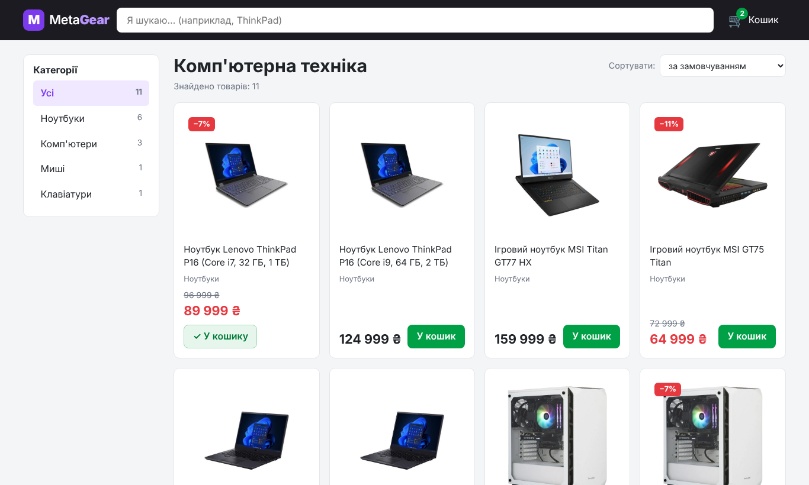
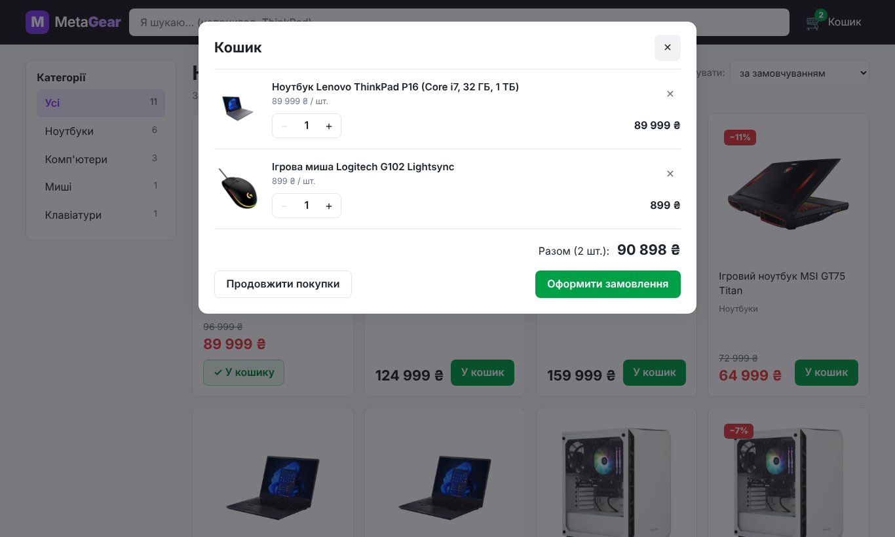
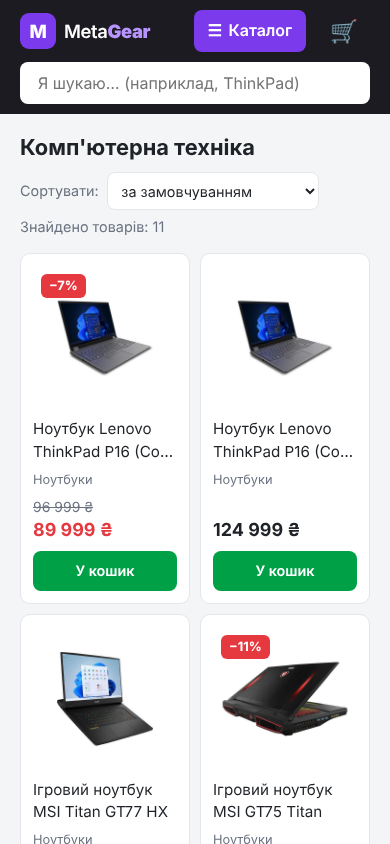

# MetaGear — каталог комп'ютерної техніки з кошиком (Vue.js 3)

Комп'ютерний практикум № 2 з дисципліни «Веб-технології».
**Тема:** інтернет-каталог комп'ютерної техніки **MetaGear** з кошиком та оформленням замовлення.
«Мета» в іграх — найефективніша тактика чи спорядження на цей момент. Тобто MetaGear — це найактуальніше залізо.



| Кошик | Телефон |
|---|---|
|  |  |

## Як запустити

Потрібен [Node.js](https://nodejs.org) (LTS, 22.18+ або 24).

```bash
npm install      # встановити залежності (один раз)
npm run dev      # запустити сайт у режимі розробки → http://localhost:5173
```

Інші команди:

```bash
npm run build    # зібрати готовий сайт у папку dist/
npm run preview  # переглянути зібрану версію
npm run lint     # перевірка коду (oxlint + ESLint)
```

## Що вміє сайт

- Каталог з 11 товарів у 4 категоріях (ноутбуки, комп'ютери, миші, клавіатури). Дані лежать у `public/products.json` і завантажуються через `fetch`.
- Фільтр за категорією, пошук за назвою і сортування за ціною чи назвою, без перезавантаження сторінки.
- Сторінка товару (модальне вікно) з описом і характеристиками.
- Кошик: додати, змінити кількість (+ / −), видалити. Лічильник у шапці й загальна сума оновлюються одразу. Кошик зберігається в `localStorage`.
- Оформлення замовлення: форма з перевіркою полів (ім'я, телефон, e-mail, доставка, місто, відділення).
- Адаптивна верстка за прийомами КП № 1 (mobile-first): на телефоні — дві колонки карток і кнопка кошика внизу екрана, з 40rem — сітка «скільки влізе», з 56rem — бокова панель категорій.

## Як виконано вимоги завдання

| № | Вимога | Де в коді |
|---|---|---|
| 1 | Каталог ≥ 8 позицій (назва, ціна, зображення, категорія), JSON через `fetch` | `public/products.json`, `loadProducts()` в `src/App.vue` |
| 2 | Фільтр за категорією і пошук через `computed` | `visibleProducts`, `categories` в `src/App.vue` |
| 3 | Кошик: додати, + / −, видалити; лічильник і сума одразу | `addToCart`, `changeQty`, `removeFromCart`, `cartCount`, `cartTotal` в `src/App.vue` |
| 4 | Власні компоненти, props + emit | `ProductCard.vue` (props `product`, `inCart`; події `add`, `open`), `CartItem.vue` (props `item`; події `increase`, `decrease`, `remove`), а також `CartModal`, `ProductModal`, `CheckoutForm`, `BaseModal` |
| 5 | Кошик у `localStorage` через `watch` | `watch(cart, …, { deep: true })` і `loadCart()` в `src/App.vue` |
| 6 | Повідомлення «кошик порожній» і «нічого не знайдено» | `CartModal.vue`, блок `v-else-if="visibleProducts.length === 0"` в `App.vue` |
| 7 | Адаптивна верстка з КП № 1, без горизонтальної прокрутки | ті самі прийоми, що в [КП № 1](https://github.com/vladkolyada/worky-site-new): `--gutter: clamp(…)`, контейнер `.wrap { width: min(100% - var(--gutter) * 2, var(--max)) }`, mobile-first `@media (min-width: …rem)` з брейкпоінтами 40/56rem, сітка `minmax(min(13rem, 100%), 1fr)`, `clamp()` для заголовків, посилання «Перейти до каталогу», `prefers-reduced-motion`. Перевірено на ширинах 320–1440 px |
| + | Оформлення замовлення з перевіркою полів | `CheckoutForm.vue` (`errors` — `computed`) |
| + | Сортування за ціною | `sort` + `visibleProducts` в `App.vue` |

## Реактивність без ручної роботи з DOM

Як на лекції 6: сторінку малює шаблон Vue, а код лише змінює дані.
- Немає `document.createElement`, `innerHTML`, `querySelector`, `addEventListener` і `v-html`.
- Події — лише в шаблоні: `@click`, `@submit.prevent`, `@keydown.esc` (закриття вікна клавішею Esc).
- Поля форм — через `v-model`, похідні дані (фільтр, сума, перевірка форми) — через `computed`, збереження в `localStorage` — через `watch`.
- `computed` нічого не змінює: сортування через `toSorted()` повертає новий масив.
- Компоненти не змінюють props: `ProductCard` і `CartItem` лише повідомляють батька через `emit`.
- Прокрутка під відкритим вікном блокується чистим CSS (`body:has(.overlay)`), без JS.
- Єдине звернення до елемента — template ref у `BaseModal.vue` (`useTemplateRef`), щоб після відкриття вікна фокус був усередині й працювали Tab та Esc. Це офіційний спосіб Vue для фокуса.

## Структура

```
public/
  products.json        дані каталогу
  images/              фото товарів
src/
  App.vue              стан застосунку: каталог, фільтри, кошик
  main.js              точка входу
  assets/main.css      загальні стилі й кольори
  utils/format.js      форматування ціни (89 999 ₴)
  components/
    ProductCard.vue    картка товару
    CartItem.vue       рядок кошика
    CartModal.vue      вікно кошика (список → оформлення → «дякуємо»)
    CheckoutForm.vue   форма замовлення з перевіркою
    ProductModal.vue   «сторінка» товару
    BaseModal.vue      спільне модальне вікно (Esc, затемнення)
```

## Як додати товар

Додайте об'єкт у `public/products.json` (унікальний `id`, `name`, `category`, `price`, `image`, за бажанням `oldPrice`, `description`, `specs`) і покладіть фото в `public/images/`. Нова категорія з'явиться в меню автоматично.

## Розгортання на GitHub Pages

У `vite.config.js` стоїть `base: './'`, тому зібраний сайт працює з будь-якої підпапки.
У репозиторії є workflow `.github/workflows/deploy.yml`: на GitHub відкрийте **Settings → Pages → Source: GitHub Actions** — після кожного push у `main` сайт збиратиметься і публікуватиметься автоматично.

## Примітки

- Навчальний проєкт: ціни, характеристики й замовлення умовні, оплати немає.
- Фото товарів узято з мого попереднього проєкту [store_site](https://github.com/vladkolyada/store_site).
